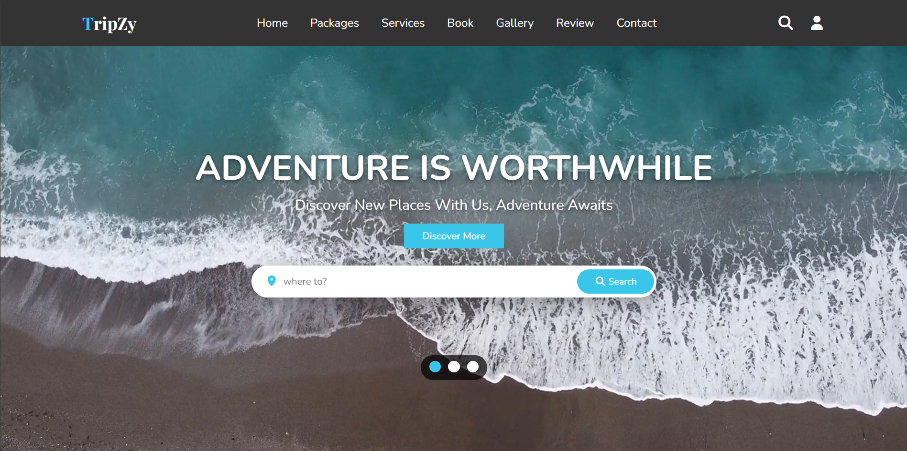

# TripZy

TripZy is a travel website I made using HTML, CSS and JavaScript. It shows travel packages, services, a photo gallery, and has forms for login, booking and contact.

**Live site:**  https://soniasonu.github.io/TripZy/

## What it has

- A home page with a background video. I can switch between 3 videos using the dots.
- A search bar on the home page. When I type a place like "Paris", it shows only that package.
- Packages section with 7 destinations, prices and star ratings.
- Services section, a Book Now form, a contact form and a review slider.
- A separate gallery page with many travel photos.
- Login and register popup that opens from the user icon.
- Works on phones too, with a menu button for small screens.

## How the forms work

The login, register, booking and contact forms are only a demo. They save the data in the browser using `localStorage`, so nothing goes to a real server. The passwords are also saved as plain text, so please do not enter a real password. I want to connect this to Django and MySQL later so the data is saved properly.

## Tools I used

- HTML, CSS and JavaScript
- Swiper.js for the review slider
- Font Awesome for the icons
- Google Fonts (Nunito and Playfair Display)
- GitHub Pages to host it

## Things I learned

- Making a layout work on both big screens and phones.
- Fixing the mobile page that was moving sideways.
- Making images and videos smaller so the site loads faster.

## How to run it

1. Download or clone this project.
2. Open the folder in VS Code.
3. Right click `index.html` and choose **Open with Live Server**. You can also just open `index.html` in the browser.

## What I want to add next
  
- A real backend with Django and MySQL for login, bookings and messages.
- Real packages with details pages.
- Sending the contact messages to my email.

